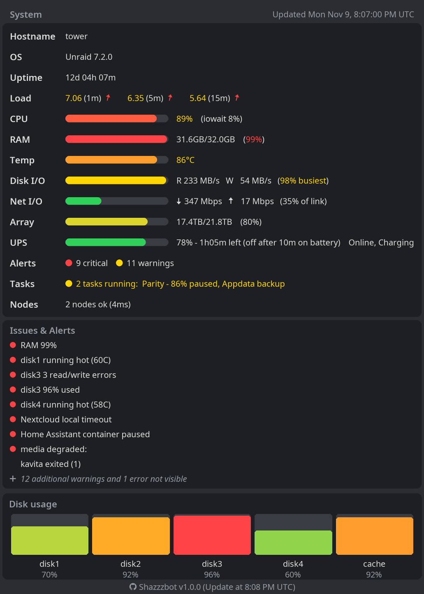

<p align="center"></p>

# Shazzzbot

[](https://github.com/mrchrisneal/shazzzbot/actions/workflows/ci.yml)
[](.coveragerc)
[](https://www.python.org)
[](https://pycord.dev)
[](compose.yaml)
[](https://unraid.net)
[](https://github.com/astral-sh/ruff)
[](https://mypy-lang.org)
[](https://github.com/PyCQA/bandit)
[](LICENSE)

**Shazzzbot: because all the good names are taken.**

<p align="center"><a href="docs/demo/frames/helper/7/system.png"></a></p>

Shazzzbot is a Discord bot that keeps watch over your Unraid server. (For the uninitiated: a bot is an automated member of your Discord server. It posts messages and answers commands like a person would, but it never sleeps.)

Shazzzbot pins a live status board in a channel you choose: CPU, memory, disks, containers, and whether your services--internal or external--are running properly. It updates that board on its own, all day, as often as Discord allows. When something goes wrong, that part of the board turns yellow or red, so you can quickly spot it before anyone asks you "Why can't I access X, Y, or Z?"

It works from the other side too: your server members get the same at-a-glance view you have, so they can check for themselves. Fewer "is it down?" messages, more time for whatever you would rather be doing.

Try the panel and the settings editor in your browser on the [preview site](https://shazzzbot.neal.media).

> [!WARNING]
> Shazzzbot is **BETA** software, provided as-is with no guarantees. It is released, but new and under active development, so some things may not work properly. If something breaks, set `log_level = "debug"` in `config.toml`, restart the bot, (try to) make it happen again, then please [open an issue](https://github.com/mrchrisneal/shazzzbot/issues/new/choose) or email [chris@neal.media](mailto:chris@neal.media) with the log ([how](https://github.com/mrchrisneal/shazzzbot/wiki/Troubleshooting#logs)). Pull requests are disabled until Shazzzbot is confirmed stable.

### The good

- One status panel that keeps itself current. The bot edits its own messages instead of spamming the channel, and sweeps up its own old posts.
- Charts that remember. CPU, RAM, disk I/O, and network I/O history is kept on disk for up to 7 days, so a restart does not wipe the graphs.
- Everything at a glance: system stats, the ten busiest containers, VMs, and processes, alerts, disk health and temperatures, live disk I/O, Docker stacks, scheduled tasks, parity checks, the mover, and Jellyfin streams.
- Service checks that follow the whole path: is the container up, does the local URL answer, does the public URL answer. Add a relay and the public check runs from outside your network, and can list the ports your containers really expose.
- Draw it your way. Each section can be an image, a phone-friendly text table, or plain Discord fields. Mirror the whole panel into other channels, each in its own style.
- Slash commands behind permission tiers. Restart an allowlisted container with a confirm button, change the chart span, or pull up the full status privately.
- An audit channel that shows who did what. Every restart, chart request, `/blowup`, and `/update` is posted there with the name of the user. A restart is posted before it runs, and if that post fails, nothing restarts. Without an audit channel, all changes are off.
- Locked down by default: read-only host mounts, a non-root container, and a Docker proxy that allows exactly three API calls.
- A small footprint that is easy to remove. An install lives in at most three directories. Beyond those, it adds a temporary work directory in `/tmp` (RAM on Unraid), one User Scripts schedule entry, and its Docker images and containers. Setup never prunes Docker images or volumes, restarts the server, or touches the array.
  - `/mnt/user/appdata/shazzzbot`: the bot, its config, its data, and its backups in `backups/`.
  - `/mnt/user/appdata/shazzzbot-helper`: the optional Host helper only.
  - `/boot/config/plugins/user.scripts/scripts/shazzzbot-helper`: the helper's User Scripts hook, with the helper only.

### The bad

- Discord caps image uploads per server and does not publish the cap. In a test, 48 uploads an hour held and refusals began near 65, counted across all channels. Uploads by other bots appear to count too. So a message that holds images changes at most once every 75 seconds, one upload shared by every output. A message with only text sections is not affected.
- Unraid only. The array, disk, and task sections read Unraid's own files.
- One Discord server per bot. Invite it anywhere else and it leaves.
- The only Docker action is restart. No start, stop, logs, or shell, on purpose.
- Seven days of history, no more.

### The ugly

This is a one-person project, built for one person's server and shared because, well, *why not?* :)

Support happens when free time does. Issues are read, pull requests are disabled until Shazzzbot is confirmed stable, and response times follow no SLA known to science.

## What it shows

The status message is a stack of embeds (the boxes Discord draws around bot content):

- **System**: the OS version, uptime, CPU, RAM, temperature, load, disk I/O, network I/O, and array usage. It also shows alerts, tasks, and Jellyfin streams. The detailed alerts need [Netdata](#requirements).
- **History**: CPU, RAM, disk I/O, and network I/O charts. In image mode, the used-space bar of each disk is under the System image.
- **Top apps**: the ten busiest containers, VMs, and host processes by CPU and by RAM.
- **Disks**: the temperature, used and free space, read and write rates, busy percent, errors, and SMART health of each array disk.
- **Docker Containers**: the engine version, the number of containers that run, and the state of each Compose stack.
- **Services**: the result of each service check (see [Service checks](https://github.com/mrchrisneal/shazzzbot/wiki/Service-checks)).
- **Tasks**: the scheduled tasks that run now and the tasks that run next, plus parity checks and the mover.
- **Forges**: the latest CI result, recent runs, recent pushes, open issues, and pull requests of each Forgejo or GitHub repository.

The Docker Containers section appears only when `[host] docker_proxy` is set. The Forges section appears only when a `[[forges]]` block is configured. The Services section appears only when service checks or a relay are configured.

The bot reads the host every `interval` seconds (default 10). Every section is an image by default. A message that holds images changes only when its images upload, on the `image_every` schedule (default 60): the text and the images go in one request. `edit_every` (default 60) applies only to messages without images. The bot keeps the chart history in `/data/history.db`, so the charts survive a restart.

## Requirements

Shazzzbot supports Unraid only. Support for other systems, platforms, and integrations depends on feedback. For the planned work, see [Roadmap](#roadmap).

- An Unraid server, and a root login on it.
- `python3` 3.11 or later on the `PATH`, for `setup.sh` itself. On Unraid, go to Apps, search for "Python 3 for UNRAID", and install it.
- Docker. The `compose-image` and `compose-build` methods also need Docker Compose v2 (the `docker compose` command). On Unraid, the Docker Compose Manager plugin supplies it.
- `curl`. The image methods (`compose-image`, `docker-run`, and `bot-only`) also need `tar`. Only `compose-build` needs `git`.
- Network access to `github.com`, and to `ghcr.io` for the image methods.
- A Discord account with permission to add a bot to your Discord server.
- For detailed alerts only: [Netdata](https://github.com/netdata/netdata). Shazzzbot adds the alarms that Netdata raises to the alerts on the panel. Without Netdata, the alerts come only from the checks of Shazzzbot itself. Tested with the `netdata/netdata:stable` image, version 2.12.3, from the Netdata template by Data-Monkey in Community Applications, with its default configuration. See [Netdata](https://github.com/mrchrisneal/shazzzbot/wiki/Installation#optional-netdata).
- For the optional [Host helper](https://github.com/mrchrisneal/shazzzbot/wiki/Host-helper) only: `/usr/bin/python3` 3.11 or later (the same "Python 3 for UNRAID" plugin supplies it), the User Scripts plugin, and a writable flash drive. The helper shows the scheduled tasks and the UPS shutdown setting.
- For `deploy.sh` only: a second machine with `bash`, `ssh`, `rsync`, and Docker. The script runs the tests in Docker before it copies anything.

## Integrations

Everything except the Unraid host is optional. `setup.sh` finds most of them on your server and asks before it turns one on.

| Integration | What Shazzzbot gets | How it connects | Setting |
|---|---|---|---|
| Unraid | System, array, disks, parity, and SMART health | Read-only mounts of the host files | `[host]` |
| Docker | Containers, Compose stacks, and the engine version; restarts for `/docker` | A docker-socket-proxy: list and info are read-only, and restart is the only change it allows | `[host] docker_proxy`, `[restarts]` |
| [Netdata](https://github.com/netdata/netdata) | Active alarms, added to the panel alerts | `GET /api/v1/alarms` | `[netdata] url` |
| [Jellyfin](https://jellyfin.org) | Active streams | `GET /Sessions`, with an API key | `[jellyfin] url`, `JELLYFIN_KEY` |
| NUT UPS | Charge, run time, and status | Read-only NUT protocol, port 3493 by default | `[ups] target` |
| [Host helper](https://github.com/mrchrisneal/shazzzbot/wiki/Host-helper) | Scheduled tasks and the UPS shutdown setting | Signed requests over a Unix socket | `[helper]` |
| Service checks | Up or down for each HTTP, HTTPS, or TCP target | Direct from the bot; public targets optionally through a relay | `[[services.checks]]` |
| Relay | Public checks from outside your network | TLS 1.3 to a relay node, with a pinned certificate | `RELAY_*` in `.env` |
| Forgejo and GitHub | CI results, runs, pushes, issues, and pull requests | The forge API, with a token (up to three forges) | `[[forges]]` |
| GitHub releases | The newest Shazzzbot version, for `/update` | `api.github.com`, every six hours | None |

## Quick start

`setup.sh` installs Shazzzbot. It checks every prerequisite and shows the results in one table. Then it offers only the install methods that work: `compose-image`, `compose-build`, `docker-run`, or `bot-only`. It asks for the Discord values and can also install the Host helper. It finds the time zone, a UPS, Netdata, Jellyfin, and the containers on the server, and asks before it uses each one.

1. Create a Discord application and bot, and invite the bot to your server. Copy the bot token, the server id, and the channel ids. The [Installation](https://github.com/mrchrisneal/shazzzbot/wiki/Installation) page shows each step.
2. On the Unraid server, as root, copy and run this line. It downloads the source of the latest release to a new folder in `/tmp` and starts `setup.sh`:

   ```bash
   d=$(mktemp -d) && curl -fsSL https://github.com/mrchrisneal/shazzzbot/releases/latest/download/source.tar.gz | tar -xz -C "$d" --strip-components=1 && bash "$d/setup.sh"
   ```

   To read the scripts first, open [`setup.sh`](https://github.com/mrchrisneal/shazzzbot/blob/main/setup.sh) on GitHub. [The setup files](https://github.com/mrchrisneal/shazzzbot/wiki/Installation#the-setup-files) links each file that it runs.

3. Answer the prompts.

To upgrade, run the same line again and choose `Upgrade`. To skip that question, add `--upgrade` at the end of the line. The `--dry-run` option prints every action and changes nothing. For the manual install steps, see [Installation](https://github.com/mrchrisneal/shazzzbot/wiki/Installation).

## Configuration

Secrets go in `.env`: `DISCORD_TOKEN`, `JELLYFIN_KEY`, the helper key, the forge tokens, and the `RELAY_*` values. [`.env.example`](https://github.com/mrchrisneal/shazzzbot/blob/main/.env.example) is an example file. All other settings go in `config.toml`. [`config.example.toml`](https://github.com/mrchrisneal/shazzzbot/blob/main/config.example.toml) is an example file with every setting, each with a comment. The setup script creates `.env` and `config.toml` when they are missing. An install or upgrade does not replace a file that exists. Only `--action migrate`, or files that you supply with `--config-source`, replace them. When it installs the host helper, it sets only `SHAZZZBOT_HELPER_KEY` and `HELPER_SOCKET_DIR` in `.env` and leaves the other lines as they are.

The bot checks `config.toml` before it connects to Discord. If a setting is unknown, missing, or not valid, the bot stops and the log names the setting. The required settings are `config_format` (`1`), `guild_id`, and one `[[outputs]]` block.

> [!TIP]
> Experiment with your config and see the result in real time in the [Shazzzbot Editor](https://shazzzbot.neal.media), a live demo. The same editor comes with the bot: once it is installed, turn on its [preview page](https://github.com/mrchrisneal/shazzzbot/wiki/Configuration#preview) to try your settings against the live data of your own server.

| Setting | Default | Effect |
|---|---|---|
| `interval` | `10` | Seconds between host readings. The minimum is 5. |
| `[[outputs]]` | none | One block for each status channel: `channel`, `sections`, `edit_every`, `image_every`, and an `[outputs.render]` table. |
| `[render]` | `image` | The mode of each section: `image`, `text`, or `embed`. `[outputs.render]` overrides it for one output. |
| `edit_every` | `60` | Seconds between edits of a message without images. The minimum is 5. |
| `image_every` | `60` | Seconds between updates of a message that holds images. The minimum is 60. All outputs share one upload every 75 seconds or more. |
| `[history] days` | `7` | Days of chart history to keep, from 1 to 7. |
| `audit_channel_id` | none | The channel for the audit log. Changes are turned off without it. |
| `commands_channel_id` | none | One more channel where the bot answers slash commands. |
| `[helper]` | none | The socket and key of the Host helper. |

For every setting, see [Configuration](https://github.com/mrchrisneal/shazzzbot/wiki/Configuration).

## Slash commands

The bot answers commands only in the output channels and in `commands_channel_id`.

| Command | Tier | Effect |
|---|---|---|
| `/about` | everyone | Shows the version, the license, and the source code link. |
| `/status` | view | Shows the first output in a private reply. |
| `/panel refresh` | operate | Edits all outputs now. |
| `/charts window` | operate | Sets the time span of the charts, from `5m` up to `[history] days`. |
| `/blowup [reason]` | operate | Pings `blowup_user_id` five times in the current channel. |
| `/docker restart` | operate | Restarts a container after a confirm button. |
| `/docker restart-stack` | operate | Restarts all containers of one Compose stack. |
| `/docker restart-group` | operate | Restarts all containers of one group in `[restarts.groups]`. |
| `/chartgen` | view | Sends up to four history charts to you in a direct message. |
| `/ratelimits` | view | Shows the learned Discord rate budget in a private reply. |
| `/update` | admin | Shows the version and the update command of the bot, each relay, and the helper. |

The tiers are `view`, `operate`, and `admin`, in `[perms.*]` in `config.toml`. Each tier lists role ids and user ids. A higher tier includes the lower tiers. If a user is in no tier, the bot refuses the command.

`/charts window`, `/blowup`, `/update`, and the `/docker` commands need an audit channel that the bot can reach. The `/docker` commands also need each container name to match a glob in `[restarts] allow`. If `[restarts] allow` is empty, the command restarts nothing. For the full flow, see [Slash commands](https://github.com/mrchrisneal/shazzzbot/wiki/Slash-commands).

## Documentation

The full documentation is in the wiki:

- [Installation](https://github.com/mrchrisneal/shazzzbot/wiki/Installation): setup steps, and deployment from another machine.
- [Configuration](https://github.com/mrchrisneal/shazzzbot/wiki/Configuration): settings, outputs, thresholds, permissions, and environment variables.
- [Slash commands](https://github.com/mrchrisneal/shazzzbot/wiki/Slash-commands): commands, permission tiers, and the restart flow.
- [Service checks](https://github.com/mrchrisneal/shazzzbot/wiki/Service-checks): check stages, table values, and the relay.
- [Host helper](https://github.com/mrchrisneal/shazzzbot/wiki/Host-helper): install, configuration, updates, and the security model of the optional root helper.
- [Security model](https://github.com/mrchrisneal/shazzzbot/wiki/Security-model): host access, container limits, and the Docker proxy allowlist.
- [Troubleshooting](https://github.com/mrchrisneal/shazzzbot/wiki/Troubleshooting): configuration errors, logs, and common symptoms.

## Security

The bot reads the host through read-only mounts. It reaches Docker only through a proxy that permits three requests: list the containers, read the engine information, and restart one container. Every command except `/about` denies access by default. Each change goes to the audit channel, and the bot posts the audit entry before it restarts a container.

The bot runs as a non-root user in a read-only container with all Linux capabilities dropped. It leaves any Discord server other than `guild_id`. The optional Host helper runs as root, accepts only signed requests over a Unix socket, and serves fixed reads to the bot. For the details, see [Security model](https://github.com/mrchrisneal/shazzzbot/wiki/Security-model).

> [!WARNING]
> Report a vulnerability privately. Do not open a public issue for it. See [SECURITY.md](SECURITY.md) for the steps.

## Development

`./test.sh` runs the tests and the `mypy` type check in a temporary container. The script reads the image name from the `FROM` line of `Dockerfile`, so the tests use the same Python image as the bot. Docker is the only requirement. The script installs the test packages from `requirements-dev.txt` at each run:

```bash
./test.sh
./test.sh -k services
```

The script passes its arguments to `pytest`. It mounts the repository read-only, so a test run changes no file.

The dependency pins are in `requirements.in` and `requirements-dev.in`. `uv` compiles them to `requirements.txt` and `requirements-dev.txt`, which lock each package with its hash. For the full rules and checks, see [CONTRIBUTING.md](CONTRIBUTING.md).

## Roadmap

These items are planned, with no dates:

- **Granular permissions.** This is the first priority. Today there are three fixed tiers: `view`, `operate`, and `admin`.
- **DashPad merge.** The long-term goal is to merge Shazzzbot and DashPad into one all-in-one tool. DashPad is a separate project and is still in progress.

## License

Shazzzbot is licensed AGPL-3.0-or-later. See [LICENSE](LICENSE). The source code is at <https://github.com/mrchrisneal/shazzzbot>. In Discord, the `/about` command shows the same link.

## Contributing

Development happens in a private repository. This repository receives one commit per release. It may not be monitored regularly, and pull requests are disabled until Shazzzbot is confirmed stable.

For the coding and project rules, see [CONTRIBUTING.md](CONTRIBUTING.md).

## Credits

Shazzzbot would not be possible without the following incredible tools, projects, and people:

### Runtime

- [Python](https://www.python.org/), the language Shazzzbot is written in.
- [py-cord](https://pycord.dev), the Discord library.
- [aiohttp](https://github.com/aio-libs/aiohttp), for the web requests.

### Rendering

- [Pillow](https://python-pillow.org), which draws the charts and the image sections.
- [Noto Sans](https://github.com/notofonts/latin-greek-cyrillic), the font in every image.
- [Octicons](https://primer.style/octicons/), for the GitHub icon.

### Editor

- [CodeMirror](https://www.npmjs.com/package/codemirror), the config editor in Shazzzbot Editor.
- [Pyodide](https://pyodide.org/), which runs the Shazzzbot Python code in the browser.

### Infrastructure

- [HAProxy](https://github.com/haproxy/haproxy), the Docker socket proxy.
- The [Python Docker image](https://github.com/docker-library/python), the base of the bot image.
- [pytest](https://docs.pytest.org/en/latest/), [mypy](https://www.mypy-lang.org/), [Ruff](https://github.com/astral-sh/ruff), and [Bandit](https://github.com/PyCQA/bandit), for the tests and checks.

For the full list of components and their licenses, see [THIRD_PARTY_NOTICES.md](THIRD_PARTY_NOTICES.md).
